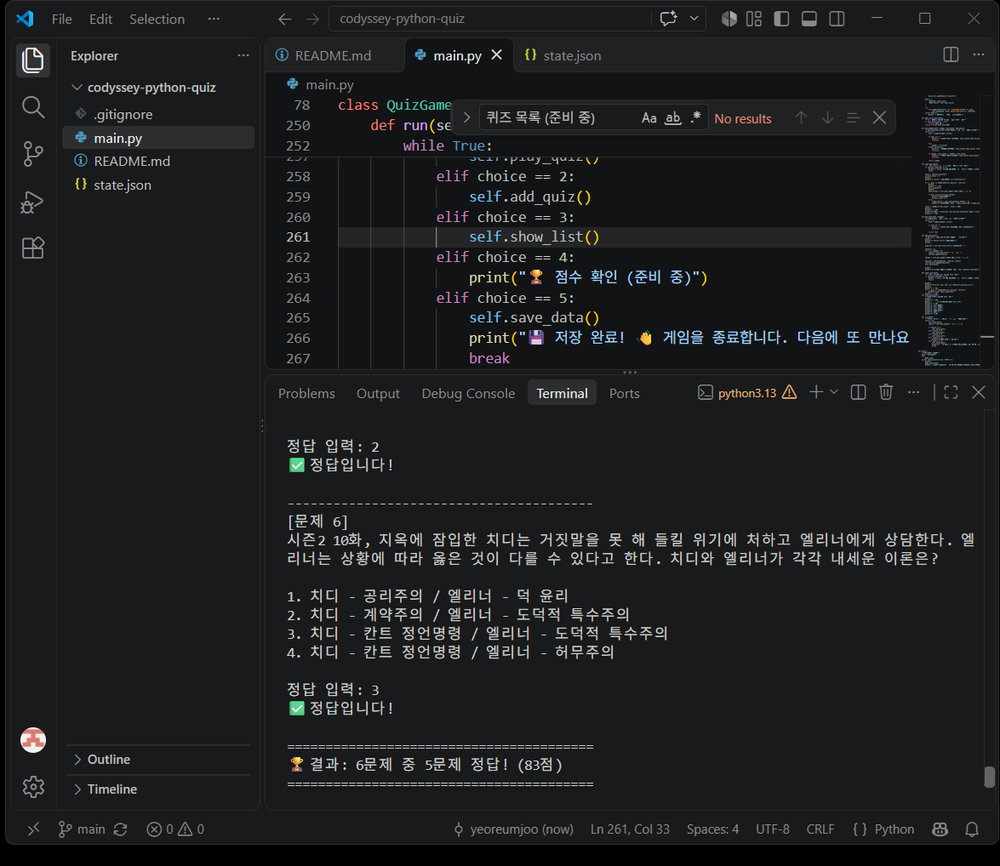
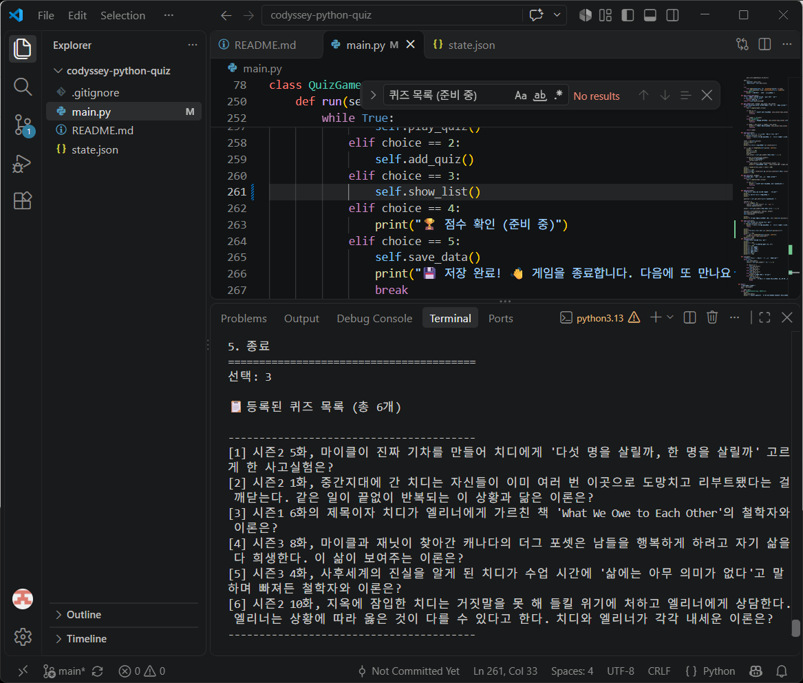
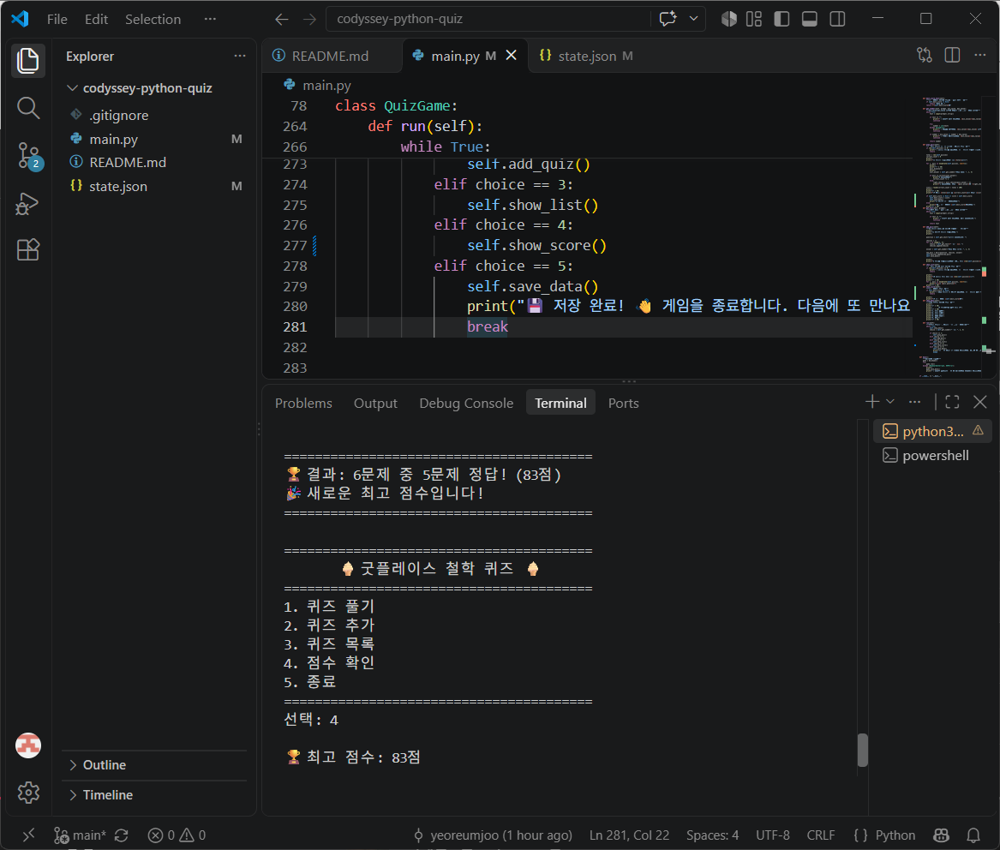
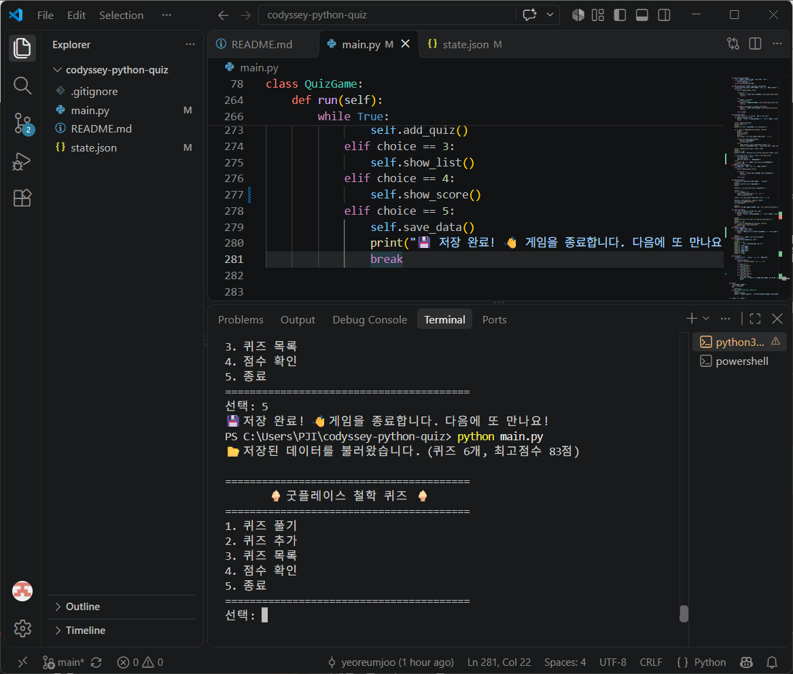
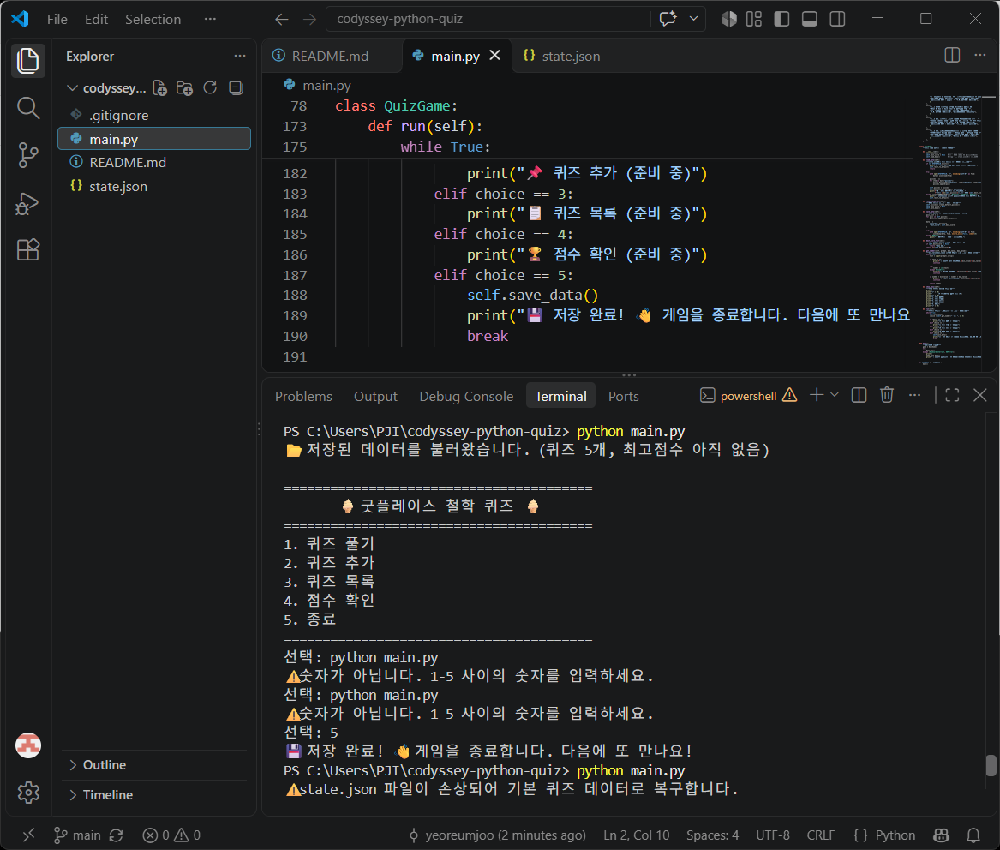
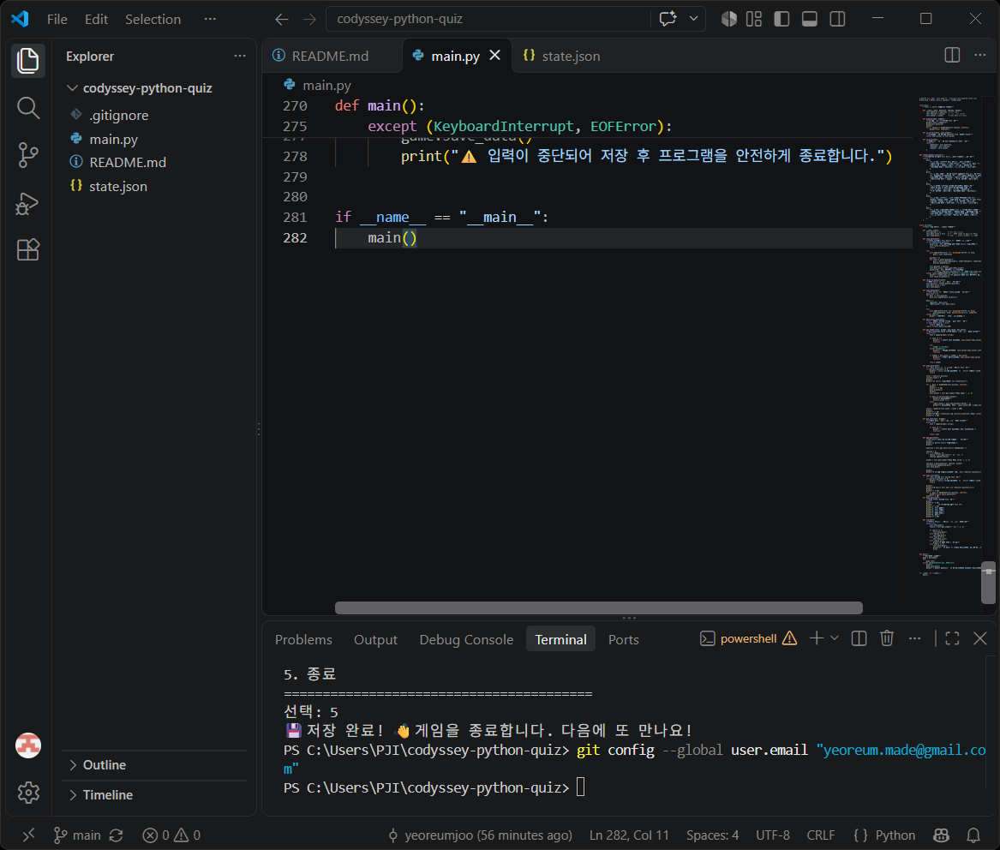

# 🍦 굿플레이스 철학 퀴즈

Python으로 만든 콘솔 퀴즈 게임입니다.
미국 드라마 **굿플레이스(The Good Place)** 에 등장하는 윤리학·철학 이론을 장면과 함께 맞히는 퀴즈를 풀고, 직접 새 퀴즈를 추가할 수 있습니다.

## 1. 프로젝트 개요

- 터미널에서 메뉴 번호를 골라 **퀴즈 풀기 / 퀴즈 추가 / 퀴즈 목록 / 점수 확인 / 종료**를 할 수 있습니다.
- 퀴즈와 최고 점수는 `state.json` 파일에 저장되어, 프로그램을 껐다 켜도 그대로 유지됩니다.
- `Quiz`, `QuizGame` 두 개의 클래스로 역할을 나누어 만들었습니다.
- 외부 라이브러리 없이 Python 표준 기능만 사용했습니다.

## 2. 퀴즈 주제와 선정 이유

**주제: 굿플레이스 속 철학 이론**

굿플레이스는 제가 가장 좋아하는 드라마입니다. 마음이 답답할 때마다 다시 보며 20번 정도 시청했습니다.
이 드라마는 윤리학 교수 치디가 친구들에게 철학을 가르치는 이야기라서, 장면마다 실제 철학 이론이 등장합니다.
그래서 "이 장면에 나온 철학은 누구의 어떤 이론일까?"를 맞히는 퀴즈를 만들었습니다.

| 번호 | 장면 | 정답 |
|---|---|---|
| 1 | 시즌2 5화, 마이클이 만든 진짜 기차 | 필리파 풋 - 트롤리 딜레마 |
| 2 | 시즌2 1화, 중간지대에서 깨달은 반복되는 리부트 | 프리드리히 니체 - 영원회귀 |
| 3 | 시즌1 6화, 'What We Owe to Each Other' | T.M. 스캔런 - 계약주의 |
| 4 | 시즌3 8화, 더그 포셋의 삶 | 제러미 벤담 - 공리주의 |
| 5 | 시즌3 4화, 치디의 수업 | 프리드리히 니체 - 허무주의 |

## 3. 실행 방법

**필요 환경:** Python 3.10 이상 (외부 라이브러리 설치 필요 없음)

```bash
# 1. 저장소 복제
git clone https://github.com/yeoreumjoo/codyssey-python-quiz.git
cd codyssey-python-quiz

# 2. 실행 (Windows)
python main.py

# 2. 실행 (macOS / Linux)
python3 main.py
```

## 4. 기능 목록

| 메뉴 | 기능 | 설명 |
|---|---|---|
| 1 | 퀴즈 풀기 | 저장된 퀴즈를 차례로 출제하고 정답/오답을 알려 줍니다. 다 풀면 점수(100점 만점)를 보여 주고, 최고 점수보다 높으면 갱신해 저장합니다. |
| 2 | 퀴즈 추가 | 문제, 선택지 4개, 정답 번호를 입력해 새 퀴즈를 등록하고 바로 저장합니다. |
| 3 | 퀴즈 목록 | 등록된 퀴즈의 문제를 번호와 함께 보여 줍니다. |
| 4 | 점수 확인 | 최고 점수를 보여 줍니다. 아직 풀지 않았으면 안내 메시지를 보여 줍니다. |
| 5 | 종료 | 데이터를 저장하고 프로그램을 끝냅니다. |

**입력 / 예외 처리**
- 입력 앞뒤 공백은 지우고 처리합니다. (예: ` 1 ` → `1`)
- 숫자가 아닌 입력(`abc`), 범위 밖 숫자(메뉴 `9`, 정답 `0`), 빈 입력(그냥 Enter)은 안내 후 다시 입력받습니다.
- `Ctrl+C` 또는 입력이 끊겨도(EOF) 오류로 꺼지지 않고, 저장 후 안전하게 종료합니다.
- `state.json`이 없으면 기본 퀴즈로 시작합니다.
- `state.json`이 손상되었으면 **백업 파일(`state.json.bak`)에서 복구**하고, 백업도 쓸 수 없으면 기본 퀴즈로 복구합니다.

## 5. 파일 구조

```
codyssey-python-quiz/
├── main.py              # 프로그램 전체 코드 (Quiz, QuizGame 클래스)
├── state.json           # 퀴즈 목록과 최고 점수 저장 파일
├── state.json.bak       # 자동 백업 파일 (실행하면 생김, Git에는 올리지 않음)
├── README.md            # 프로젝트 설명서 (이 문서)
├── .gitignore           # Git에 올리지 않을 파일 목록 (Python 템플릿)
└── docs/
    └── screenshots/     # 실행 화면 캡처
```

**클래스 구조 (`main.py`)**

| 클래스 | 역할 | 주요 메서드 |
|---|---|---|
| `Quiz` | 퀴즈 한 문제 | `display()` 문제 출력, `is_correct()` 정답 확인, `to_dict()` 저장용 변환 |
| `QuizGame` | 게임 전체 관리 | `run()` 메뉴 반복, `play_quiz()`, `add_quiz()`, `show_list()`, `show_score()`, `load_data()`, `save_data()`, `get_number()` / `get_text()` 입력 검증 |

**클래스를 사용한 이유**
- **데이터와 기능을 한 묶음으로 관리하기 위해서입니다.** 퀴즈 한 문제의 데이터(문제, 선택지, 정답)와 그 문제로 하는 일(출력, 정답 확인)을 `Quiz` 안에 함께 두어, 어디서든 `quiz.is_correct(답)`처럼 쓸 수 있습니다.
- **게임 상태를 한곳에서 관리하기 위해서입니다.** 퀴즈 목록과 최고 점수는 여러 기능이 함께 쓰는 값입니다. 함수만 쓰면 이 값들을 전역 변수로 두거나 매번 인자로 넘겨야 하지만, `QuizGame`에서는 `self.quizzes`, `self.best_score`로 모든 메서드가 같은 상태를 공유합니다.
- **고치고 늘리기 쉽게 하기 위해서입니다.** 역할이 나뉘어 있어서, 예를 들어 퀴즈에 "힌트"를 추가하려면 `Quiz`만, 저장 방식을 바꾸려면 `load_data()` / `save_data()`만 고치면 됩니다.

## 6. 데이터 파일 설명 (`state.json`)

- **경로:** 프로젝트 루트의 `state.json` (`main.py`와 같은 폴더)
- **역할:** 퀴즈 목록과 최고 점수를 저장해, 프로그램을 다시 실행해도 데이터가 유지되게 합니다.
- **인코딩:** UTF-8 (한글이 그대로 저장됩니다)
- **언제 저장되나요?** 퀴즈 추가, 최고 점수 갱신, 종료(메뉴 5 / Ctrl+C) 때
- **저장 방식:** 파이썬의 `json` 모듈로 퀴즈 객체를 딕셔너리로 바꿔(`to_dict()`) 저장하고, 불러올 때 다시 `Quiz` 객체로 만듭니다. `ensure_ascii=False`로 한글을 그대로, `indent=4`로 사람이 읽기 쉽게 저장합니다.

**스키마 (데이터 구조)**

```json
{
    "quizzes": [
        {
            "question": "문제 내용",
            "choices": ["선택지1", "선택지2", "선택지3", "선택지4"],
            "answer": 1
        }
    ],
    "best_score": 83
}
```

| 키 | 자료형 | 설명 |
|---|---|---|
| `quizzes` | list | 퀴즈 목록 |
| `quizzes[].question` | str | 문제 |
| `quizzes[].choices` | list (str 4개) | 선택지 4개 |
| `quizzes[].answer` | int (1~4) | 정답 번호 |
| `best_score` | int 또는 null | 최고 점수 (100점 만점). 아직 안 풀었으면 `null` |

### 백업과 복구 전략

- **백업:** 저장할 때마다 같은 내용을 `state.json.bak`에도 저장합니다. 그래서 `state.json`이 망가져도 마지막으로 정상 저장된 데이터가 남아 있습니다.
- **불러오는 순서:**
  1. `state.json`이 없으면 → 기본 퀴즈 5개로 시작
  2. `state.json`을 정상적으로 읽으면 → 그대로 사용
  3. `state.json`이 손상되었으면 → `state.json.bak`에서 복구하고 다시 저장
  4. 백업 파일도 없거나 손상되었으면 → 기본 퀴즈 5개로 복구
- **저장 실패:** 폴더 권한이나 디스크 공간 문제로 저장하지 못하면 프로그램을 끄지 않고 안내 메시지를 보여 줍니다.
- `state.json.bak`은 실행할 때마다 다시 만들어지는 파일이라 `.gitignore`에 넣어 Git에는 올리지 않습니다.

### JSON 저장 방식의 한계

- **전체를 매번 다시 씁니다.** 퀴즈 하나만 추가해도 파일 전체를 새로 저장하고, 시작할 때 전체를 메모리에 올립니다. 퀴즈가 수천~수만 개로 늘어나면 저장과 불러오기가 느려지고 메모리도 많이 씁니다.
- **동시에 여러 명이 쓰기 어렵습니다.** 두 프로그램이 동시에 저장하면 한쪽 내용이 덮어써질 수 있습니다.
- **검색과 조건 조회가 불편합니다.** 특정 퀴즈만 찾으려면 전체 목록을 처음부터 확인해야 합니다.
- **저장 도중 꺼지면 파일이 깨질 수 있습니다.** 그래서 이 프로젝트는 백업 파일로 대비했습니다.
- **대안:** 데이터가 많아지거나 여러 사용자가 쓰게 되면 파이썬 기본 내장 데이터베이스인 **SQLite**(`sqlite3` 모듈) 같은 데이터베이스를 쓰는 것이 좋습니다. 필요한 부분만 읽고 쓸 수 있고, 저장이 중간에 실패해도 데이터가 깨지지 않게 보호해 줍니다.

## 7. 실행 화면

| 메뉴 | 퀴즈 풀기 |
|---|---|
|  |  |

| 퀴즈 추가 | 퀴즈 목록 |
|---|---|
|  |  |

| 점수 확인 | 재실행 후 데이터 유지 |
|---|---|
|  |  |

| 잘못된 입력 처리 |
|---|
|  |

## 8. 개발 환경

| Python 버전 | Git 설정 | VS Code |
|---|---|---|
|  |  |  |

## 9. Git 작업 기록

**총 커밋 수: 17개** (GitHub가 만든 `Initial commit` 제외, 2026-11-15 기준)

아래는 15번째 커밋까지의 `git log --oneline --graph` 결과입니다. 이후 16번째(백업 기능 추가), 17번째(이 README 보완) 커밋이 이어집니다.

```
* f81d17a Docs: README에 Git 기록 스크린샷 추가
* 0327129 Docs: README에 clone·pull 실습 기록 추가
* 666609b Fix: 목록 스크린샷 파일 이름 수정
* bbbbb86 Docs: README 작성 및 실행 화면 스크린샷 추가
* adac1ea Feat: 최고 점수 갱신·저장과 점수 확인 기능 구현
* 711c818 Feat: 퀴즈 목록 보기 기능 구현
* 33b4b83 Feat: 퀴즈 추가 기능 구현 (입력 검증, 파일 저장)
*   5b27989 Merge: 퀴즈 풀기 기능 main에 병합
|\
| * 5544ddf Feat: 퀴즈 풀기 기능 구현 (출제, 정답 확인, 결과 표시)
|/
* 3fcf48b Feat: state.json 저장/불러오기와 손상 파일 복구 구현
* 5b3d385 Feat: 숫자 입력 검증과 Ctrl+C 안전 종료 처리 추가
* b590368 Feat: QuizGame 클래스와 메인 메뉴 구현
* ffd017c Feat: 굿플레이스 철학 기본 퀴즈 5개 추가
* 0f4499d Feat: Quiz 클래스 구현 (문제 출력, 정답 확인)
* 3fe6f10 Docs: README 프로젝트 소개 추가
* 2f1d47f Initial commit
```

- 기능 단위로 커밋했습니다. (`Feat:` 기능, `Fix:` 수정, `Docs:` 문서, `Merge:` 병합)
- 퀴즈 풀기 기능은 `feature/quiz-play` 브랜치에서 개발한 뒤 `main`에 병합했습니다.
- 사용한 Git 명령어: `init`, `add`, `commit`, `push`, `pull`, `checkout`, `merge`, `clone`
- clone·pull 실습: 다른 폴더에 clone해서 수정·push한 뒤, 원래 폴더에서 pull로 받아왔습니다.

| Git 커밋 기록 (`git log --oneline --graph`) | clone·push·pull 실습 |
|---|---|
|  |  |